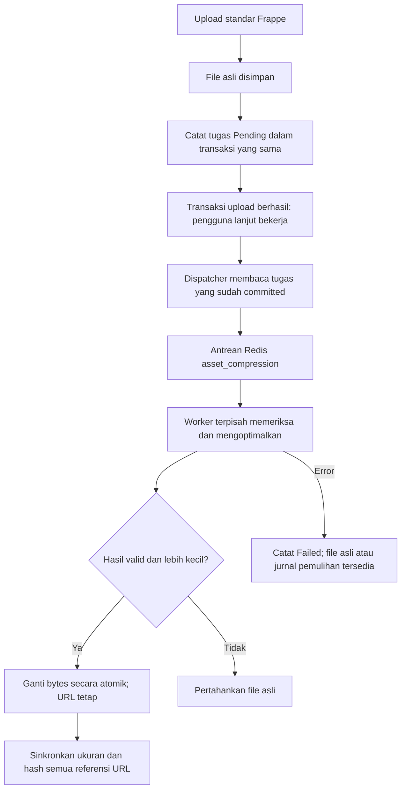

# Kompresi attachment di background

Status 26 Oktober 2026: implementasi dan pengujian lokal pada blitz.local. Belum dideploy ke production. Fitur secara default OFF sampai site mengaktifkannya dan worker disiapkan.

## Flow pengguna

Pengguna memilih file dan upload melalui form seperti biasa. File asli langsung tersimpan serta dapat dibuka. Pengguna dapat melanjutkan menyimpan/mengerjakan form. Tidak ada tombol kompresi, dialog baru, atau kewajiban menunggu hasil optimasi.

Upload masih membutuhkan transfer jaringan, penulisan file dan pencatatan satu tugas database ringan. Modul ini tidak melakukan kompresi atau menghubungi Redis dari request upload. Proses EXIF JPEG bawaan Frappe tetap seperti sebelumnya. Ini bukan janji waktu upload identik sampai hitungan milidetik.

## Cakupan dan kebijakan

- Hook terpusat `File.after_insert`: attachment sidebar, Attach/Attach Image, dan jalur lain yang membuat record File lokal. Tidak perlu JS per form. Karena terpusat, file hasil proses aplikasi/email yang membuat File baru juga dapat masuk antrean; format yang dilindungi tetap dilewati.
- File public/private tetap di lokasi dan URL semula. Hak akses tetap. Memilih file library yang sudah ada atau URL eksternal bukan upload byte baru. Record File baru yang menunjuk URL sama aman diproses ulang secara idempotent.
- Target default 2 MiB = 2.097.152 byte per file. File yang sudah <= target tidak diubah.
- JPG/JPEG dan PNG single-frame: optimasi encoder dan resize bertahap hingga sisi panjang maksimal 3000, 2400, lalu 1800 pixel. JPEG quality 85, 80, 75; PNG mempertahankan format/transparansi. Berhenti saat target tercapai. Jika masih di atas target, gunakan hasil terkecil yang valid dan lebih kecil dari asli.
- PDF: Ghostscript menurunkan resolusi gambar warna/abu-abu ke 150 DPI dan monokrom 300 DPI. Tidak meraster seluruh halaman; teks/vector tetap teks/vector. Jumlah halaman diperiksa.
- Signed/interactive PDF, AcroForm/XFA, annotation, embedded attachment, PDF/A/OutputIntents dan PDF terenkripsi dilewati secara konservatif. Deteksi bisa menghasilkan false positive; itu mempertahankan dokumen asli.
- ZIP/RAR, Office dan tipe lainnya dipertahankan. Animated PNG dan gambar dengan mismatch format/ekstensi juga dilewati. Tidak mengubah tipe file diam-diam.
- Batas pemrosesan default 100 MiB dan PDF maksimal 200 halaman. Gambar menggunakan ambang 24 juta pixel; Pillow warning diperlakukan sebagai error. Di atas batas atau gagal parsing tidak merusak original.
- Optimizer berjalan dalam subprocess: batas memori virtual 768 MiB, CPU 70 detik, wall timeout 90 detik; Ghostscript timeout 60 detik. Job timeout 180 detik. Satu worker kompresi disarankan pada tahap awal.
- Sebelum memproses, worker memerlukan ruang kosong minimal 3 x ukuran input + 64 MiB. Kompresi tidak menjamin upload sukses pada server yang sudah kehabisan ruang.

## Status operasional

System Manager dapat membuka daftar **Asset Compression Job**. Setiap record berisi File ID, status, attempts, ukuran awal/akhir, dan reason code; tidak menyimpan isi dokumen atau nomor paspor. Field File ID sengaja berupa Data, sehingga tugas kompresi tidak memblokir penghapusan File oleh pengguna.

| Status | Arti |
| --- | --- |
| Pending | Upload tercatat; menunggu dispatcher |
| Queued | Sudah dikirim ke antrean khusus |
| Processing | Worker sedang mengerjakan |
| Done | Hasil lebih kecil dipasang; bisa tetap >target dengan reason optimized_above_target |
| Skipped | Kecil, tipe dilindungi/tidak didukung, file hilang, atau storage nonstandar |
| Failed | Error pemrosesan; membutuhkan retry atau pemeriksaan pemulihan |

Dispatcher berjalan tiap menit pada scheduler production. Maksimal 20 tugas per putaran. Job Failed/Queued/Processing yang belum terminal dapat dikirim ulang setelah 30 menit, dengan maksimal 3 percobaan pemrosesan. Pending tetap menunggu jika Redis mati. File asli tetap bisa digunakan saat worker mati atau antrean panjang. Setelah 3 kegagalan, System Manager perlu memeriksa alasan sebelum mengatur ulang attempts/status; tidak retry tanpa batas.

## Konsistensi dan pemulihan

- Lock per URL mencegah dua worker mengubah file bersama-sama.
- Hasil dipasang hanya bila sumber masih memiliki hash yang sama dengan snapshot sebelum kompresi.
- Semua record File yang memakai URL sama mendapat ukuran/hash final. Record invoice, nilai transaksi dan field attachment tidak disimpan ulang.
- Penulisan menggunakan filesystem rename atomik. Backup berupa hardlink dan jurnal privat dibuat sebelum rename. Jurnal memungkinkan tugas yang sama menyelesaikan metadata setelah crash antara rename dan commit database.
- Jika update DB gagal sebelum commit, original dipulihkan. Jika commit sebenarnya sudah terjadi, backup/jurnal dipertahankan sampai replay memastikan konsistensi. Filesystem dan DB bukan satu transaksi: sesaat setelah crash metadata bisa belum selaras sampai retry/recovery berjalan.
- Original/hasil sementara berada pada private/asset_compression (mode direktori 0700), bukan folder public. Backup original dibuang setelah commit berhasil. Tidak menyimpan dua versi permanen pada disk yang sama.
- File pada symlink, path traversal, URL eksternal, atau storage nonstandar dilewati. Storage vendor berbasis symlink memerlukan adapter terpisah sebelum diberi klaim cakupan.
- Jangan menghapus jurnal atau file .original secara manual saat job Failed/Processing. Itu bahan pemulihan. Work directory yang tertinggal akibat kill paksa perlu dibersihkan operator setelah memastikan worker terkait mati. File lock kecil dipertahankan untuk menghindari race penghapusan lock.
- Mematikan fitur menghentikan job baru dan pemasangan hasil baru, bukan mengembalikan file yang sudah berhasil diperkecil.

## Pengujian 26 Oktober 2026

22 tes integrasi/safety memakai upload handler Frappe dan dokumen sintetis. Termasuk worker Redis di proses terpisah, rollback outbox, queue outage, kegagalan optimizer/DB, crash setelah rename, duplicate URL/delivery, public/private, penghapusan attachment, path traversal/symlink, ruang kosong, batas input/retry, animated/transparent PNG, PDF signed/encrypted dan searchable text.

Uji layanan background yang polling otomatis (tanpa memanggil worker dari request upload):

| Sampel sintetis | Awal | Hasil | Waktu handler upload + commit |
| --- | ---: | ---: | ---: |
| PNG dokumen teks | 12.966.037 byte | 74.882 byte | 0,961 detik |
| PDF scan/noise 1 halaman | 5.796.331 byte | 212.886 byte | 0,193 detik |

Sesudah upload, bytes asli diperiksa masih tersedia. Layanan background kemudian memproses keduanya sampai Done dengan URL tetap. Waktu di atas adalah pengamatan dua sampel di laptop lokal, bukan SLA atau perbandingan kecepatan sebelum/sesudah. Rasio tersebut bukan prediksi penghematan lampiran production. Hasil PNG/PDF sintetis diperiksa visual, teks terbaca. File uji di site dibersihkan; bukti sintetis tetap pada work lokal, tidak di-commit.

Fingerprint dua invoice contoh, GL terkait dan PPN TEST dibandingkan sebelum/sesudah suite final. Pengujian template invoice sebelumnya tetap dijalankan terpisah.

Belum dilakukan: uji klik browser pada 115 DocType satu per satu, load test concurrency production, corpus scan paspor/visa nyata, audit filesystem production, adapter symlink/object storage, dan kompresi file historis. UAT dokumen asli tetap diperlukan sebelum rollout production. Deteksi signature diuji dengan marker ByteRange sintetis, bukan sertifikat digital asli; PDF terenkripsi diuji dengan file terenkripsi sintetis. Hasil tes lokal bukan jaminan aman untuk semua dokumen.

## Source dan operasional

- `kulkul_erp/asset_compression/events.py`: pencatatan tugas dan dispatcher.
- `engine.py`: optimasi gambar/PDF dalam subprocess terbatas.
- `worker.py`: lock, konsistensi referensi, swap dan recovery.
- `local_service.py`: layanan development khusus blitz.local, tanpa mengaktifkan scheduler umum.
- `kulkul_erp/kulkul_erp/doctype/asset_compression_job/`: metadata pemantauan.
- `tests/test_asset_compression.py`: tes lokal; tidak ditujukan pada production.

Baca [panduan deploy dan rollback](asset-compression-deployment.md) untuk konfigurasi server. Source file baru tidak membutuhkan perubahan print format invoice.
